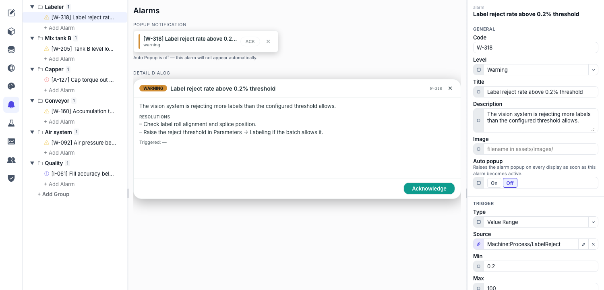

# Alarms & recipes

Two features that turn a dashboard into an operations tool: condition-based **alarms** with acknowledgement, and **recipes** — named parameter sets you push to and pull from live variables.

## Define an alarm

1. **Open the Alarms area** — Add an alarm (organise them in groups if you like).
2. **Point it at a variable** — Bind the alarm's **Source** to the tag it watches.
3. **Choose a trigger type** — **Boolean** — fires on `true` or `false`. **Value Range** — fires while the value lies between **Min** and **Max**, both included: the range you set is the alarm range, not the normal one. Leave one empty to open that side, so **Min** `80` alone fires at 80 and above, and **Max** `10` alone at 10 and below.
4. **Set severity & presentation** — Pick **Error**, **Warning** or **Info**, give it a **Code** (`W-318`), a **Title** and a **Description**, and optionally an **Image** (a filename in `assets/images/`).

Three more fields turn a definition into something an operator can act on:

- **Auto popup** — **On** raises the alarm popup on every display the moment the alarm goes active. Leave it **Off** and it only shows up in the lists.
- **Resolutions** — an ordered list of what to check or do, shown in the alarm's detail dialog. This is where the tribal knowledge goes, instead of in a folder nobody opens.
- **Values** — variables whose value you want in the alarm text. Each row is numbered: `{1}` in the **Title** or **Description** shows the first one, `{2}` the second, with the same functions a String Expression takes (`{Round1(1)}`, `{Signed(2)}`). While the alarm is active the text shows the live value; once it has cleared, and in the history, it shows the value from the moment the alarm went off. Write `Tank temperature {Round1(1)} °C` and the operator reads `Tank temperature 81.5 °C`. A value can also be one element of an array, with its index fixed or bound to another value, or a member of one element of a struct array; history keeps the element the index named when the alarm went off.
- **Acknowledgment → Needs acknowledgement** — off for an alarm nobody has to acknowledge (see below). **Allowed groups** — who may acknowledge it. Empty means anyone; set it and only those groups can clear the alarm. See [Users, groups & permissions](users.md).

The centre of the editor previews both surfaces live — the popup notification and the detail dialog — so you can see what the operator will read while you write it.

Each alarm has a **Needs acknowledgement** switch, on by default. Turned off, the alarm fires already acknowledged: it shows no ACK, is not counted as unacknowledged and Acknowledge All passes it by, while it still appears, pops up and goes to the history like any other. Use it for messages the operator only needs to see, such as *Zeroing required*.

Surface them with the **Alarm List** and **Alarm History** widgets, and show a live count anywhere with the `$alarmCount` source (filter by `all` / `unacked` / `error` / `warning` / `info`). The Alarm List draws no frame of its own, so it sits in whatever card or page you place it on; the Alarm History has an **Own frame** toggle for the same. Clear the **Title** to drop the header band too.

For a touch panel, the **Alarm List** has six more options. **Row size: Touch** draws each alarm as a tap-sized card with a severity edge, its value, its time and whether it is new, acknowledged or cleared. **Severity mark** shows a row's level as a stripe on the left (the default), as the whole row in the level colour, or only through the coloured icon. **Show** picks what the list holds: the active alarms, the cleared ones (History) or both, so one list can replace the pair; bind it to switch the view from elsewhere on the page. **Filter chips** puts All / Active / History in the header so the operator can switch, starting from **Show**. **Acknowledge: Off** drops the ACK on every row and the Acknowledge All button, so a Button with the **Acknowledge All Alarms** action does it instead: one large button, sized and styled like the rest of the screen. **Second line: Description and time** adds the alarm's description. Left at their defaults, the list looks as it always did.

An alarm's source tag is subscribed whether or not any page shows it, so alarms keep evaluating on screens that never display them.

## Build a recipe

1. **Create a dataset type** — In the **Recipes** area, add a dataset **type** — the shape of one recipe (e.g. "Product profile").
2. **Add parameters** — For each value in the recipe, click **+ Add** and give it a **label** and a **binding** to the variable it maps to; the data type follows from the tag.
3. **Save datasets** — Store named datasets under the type — one per product, grade or batch.

The two runtime operations are **download** — writing a dataset's values to their variables, loading the recipe into the machine — and **upload**, capturing current live values back into a dataset.

## Put a recipe screen in front of the operator

The two operations are ordinary [actions](actions.md#machine) — put **Recipe: Load** and **Recipe: Save** on a Button, with the dataset either fixed or bound, and `onSuccess` / `onFailed` handlers to tell the operator how it went. **Verify** on a load reads the values back and fails the action if they didn't take.

There is no dedicated recipe-picker widget, because what a recipe screen should look like varies too much between plants. Build the list of saved datasets from a [Repeater](properties.md#repeating-widgets-over-an-array-repeater) instead: set its **Items** to the saved recipes and lay out one row. Each row's element carries `id`, `name`, `description`, `lastLoaded` and `values`, the dataset's stored values by parameter id; type the member into a **Repeat Item** field — Labels showing `name` and `values/target`, and a Container whose **Recipe: Load** takes its **Dataset** from `id`. Read **`$recipe`** beside it for the loaded recipe's name, or to flag *Parameters changed*.

To show which settings differ from the saved recipe, give each one **`$recipe`** with *Parameter changed* (`parameterChanged`) and the parameter: true while that one live value differs from the loaded dataset. Bind a Number Input's **Value color** to it through an `$if` to mark the value, or a row's **Visible** to list only the changed ones. *Saved value of a parameter* (`parameterValue`) reads the stored value itself, for a "saved → live" line.

For a screen that needs more than that, write a [custom widget](custom-widgets.md) — a short job with the pieces the SDK hands you:

- Bind a `record-list` field to the **`$recipeList`** source for the grid of saved datasets.
- Read state with **`$recipe`** — *Loaded recipe name* (`activeName`), *Is loaded* (`loaded`), *Parameters changed* (`parametersChanged`, true when live values have drifted from the loaded set), or per parameter *Parameter changed* (`parameterChanged`) and *Saved value of a parameter* (`parameterValue`).
- Call **`recipeDownload(datasetId)`** and **`recipeUpload(datasetId)`** from your buttons, and read the configuration with `useRecipeConfig` / `useRecipeState`.

The same two operations are also available over REST at `POST /api/recipes/datasets/{id}/download` and `/upload`, which is the route to take from an external MES or scheduler. A download honours the same per-variable write permissions as a button does: a parameter bound to a variable you [restricted to a group](users.md) is skipped with `permission_denied` unless the request carries the credentials of a user in that group.
