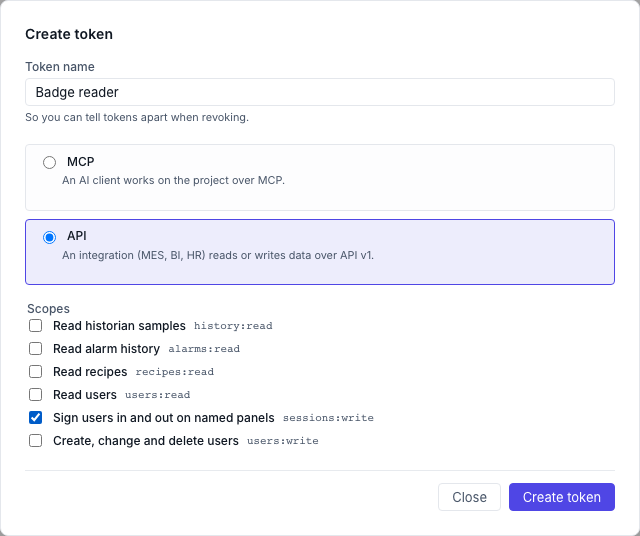

# Connecting other systems (API v1)

API v1 lets another system talk to NEXT HMI over HTTP: a MES that reads recipes,
a BI tool that pulls historian data or alarm history, an HR system that keeps the
operator accounts up to date, a badge reader that signs an operator in on a
panel. It is a small, versioned API: the routes and field names on this page
stay the same for as long as v1 exists.

Every request names one project, by its id. The API works the same whether that
project is running or stopped, because it reads and writes the project's own
files. The one exception is signing someone in or out on a panel, which needs
the project running. Nothing in it writes to the PLC.

API v1 is the only way in meant for other systems. The other addresses the
app uses are its own internals and can change in any release. What the
operator screens leave open without any credential is listed in
[What is reachable without a password](network-access.md).

## Giving a system access

There are two ways to sign a request.

**An API token (recommended).** A token is a long random string that unlocks
every project on this installation, but only the parts you tick when you create
it. Hand each system its
own token, so you can take one back without touching the others.

1. On the Manager dashboard, open **Settings**.
2. In the **Tokens** section, click **Create token** and choose the kind **API**.
3. Give it a name you will recognise later (*HR system*, *Power BI*).
4. Tick the scopes the system needs, and nothing more (see the table below).
5. Click **Create token**, then copy the token. It is shown **once**: only a
   hash of it is stored, so a lost token cannot be recovered, only replaced.



The dialog also shows a ready-made `curl` command for the new token; replace
`<project-id>` in it with a project's id. The **Tokens** section lists every
token, with **Revoke** on each.

**The device-admin password.** The password that unlocks the dashboard also
works, over HTTP Basic, with the username `admin`. It reaches every project and
every scope, so keep it for your own scripts and testing. After five wrong
passwords the API, and the dashboard sign-in, lock for a minute. A correct
password over the API does not wipe that count; a correct one entered anywhere
else (the dashboard sign-in, a password change, pairing an MCP client or another
machine), or the lock itself, starts it again.

A username and password from the project's *Users* list never works here.
Neither does an MCP token: those are for AI agents (see [AI agents over MCP](mcp.md)).

### Scopes

| Scope | Lets the system |
|---|---|
| `history:read` | Read historian samples |
| `alarms:read` | Read the alarm history, including who acknowledged each alarm |
| `recipes:read` | Read the recipe types and their saved datasets |
| `users:read` | Read the user list (never a password) |
| `users:write` | Create, change and delete users |
| `sessions:write` | See which named panels are open, and sign users in and out on them |

**`users:write` does not include `users:read`.** A token with only
`users:write` can create, change and delete users, but gets `403` when it asks
for the user list. A system that both reads and updates users, such as an HR
sync, needs both scopes ticked.

## Making a request

All addresses start with the dashboard's own address, then
`/api/v1/projects/<project id>/`. The project id is the name in the project's
URLs (`/runtime/<id>/`).

Send the token in the `Authorization` header:

```bash
curl -H "Authorization: Bearer $TOKEN" \
  "https://hmi.local:8443/api/v1/projects/line-a/recipes"
```

Or the device-admin password, with `-u`:

```bash
curl -u "admin:$DEVICE_ADMIN_PASSWORD" \
  "https://hmi.local:8443/api/v1/projects/line-a/recipes"
```

What the answers mean:

| Status | Meaning |
|---|---|
| `200` | Done |
| `401` | No credential, a wrong one, or a revoked token |
| `403` | The token lacks the scope this route needs |
| `401` (panel sign-in) | The HMI user's username or password is wrong |
| `404` | No such project, no such user, or no open panel with that name |
| `409` | The project's `users.json` is damaged (repair it in the editor first), or a panel route was called while the project is stopped |
| `422` | Something in the request is not valid; the `detail` field says what |
| `429` | Too many wrong passwords; wait a minute |

### Times

Wherever a request takes a time, write it as ISO-8601 (`2026-11-03T08:00:00`,
UTC when no offset is given), as `now`, or relative to now: `-30s`, `-15m`,
`-1h`, `-7d`. Every time in an answer is ISO-8601 in UTC, with its offset.

### Long lists come in pages

Historian samples and alarm history come in pages. An answer looks like this:

```json
{ "items": [ ... ], "nextCursor": "eyJrIjoi..." }
```

To get the next page, repeat the same request with `&cursor=<nextCursor>`. When
`nextCursor` is `null` you have everything that request asked for.

A cursor only walks one request's results; it is not a bookmark to come back to
later. To keep another system up to date, poll with `start` instead:

- **Historian samples** reach the database in batches, a second or two after
  they were measured. Set `start` a minute before the newest `timestamp` you
  already have, and drop the rows you already have (same `variable` and
  `timestamp`).
- **Alarm history**: set `start` to the newest `clearedAt` you already have, and
  drop the alarms whose `id` you already have.

Add `&format=csv` to get the page as a CSV file instead, ready for a
spreadsheet. The next cursor then comes in the `X-Next-Cursor` response header,
which is missing on the last page. A text that starts with `=`, `+`, `-` or `@`
gets a `'` in front, so the spreadsheet shows it instead of running it as a
formula.

## What you can read and change

### Historian samples

```bash
curl -H "Authorization: Bearer $TOKEN" \
  "https://hmi.local:8443/api/v1/projects/line-a/history?variables=LinePLC:Tank/Level,LinePLC:Tank/Temp&start=-1h"
```

`variables` names one or more recorded variables, separated by commas, as
`<datasource>:<path>` — the same keys the [historian](historian.md) records. `start` is required; `end` is `now`
unless you give one. You get every recorded sample in that window, oldest first,
never thinned out: `{ "variable", "timestamp", "value" }`. A page holds up to
`1000` samples unless you set `limit`, which goes up to `10000`.

### Alarm history

```bash
curl -H "Authorization: Bearer $TOKEN" \
  "https://hmi.local:8443/api/v1/projects/line-a/alarms/history?start=-7d&format=csv"
```

Each cleared alarm, oldest first by when it cleared, with its code, level,
title, when it came and went, and whether, when and by whom it was acknowledged
(`acked`, `ackedAt`, `ackedBy`). `start` and `end` select on the moment an
alarm cleared. An alarm that is still active is not in the history yet. The project keeps
the newest 500 cleared alarms. A page holds up to `100` unless you set `limit`,
which goes up to `500`.

### Recipes

```bash
curl -H "Authorization: Bearer $TOKEN" \
  "https://hmi.local:8443/api/v1/projects/line-a/recipes"
```

Every recipe type with its parameters and saved datasets, and which dataset was
loaded last. Reading recipes never loads one to the machine.

### Users

List the users and the groups they can be in:

```bash
curl -H "Authorization: Bearer $TOKEN" \
  "https://hmi.local:8443/api/v1/projects/line-a/users"
```

Each user comes back as `{ "id", "username", "groups", "passwordSet" }`.

Create a user, or change one, with `PUT` and the user's id in the address:

```bash
curl -X PUT -H "Authorization: Bearer $TOKEN" -H "Content-Type: application/json" \
  -d '{"username": "jdoe", "password": "a-long-password", "groups": ["operator"]}' \
  "https://hmi.local:8443/api/v1/projects/line-a/users/jdoe"
```

Send only what changes: a field you leave out keeps its current value, and
leaving out the password keeps the current password. A new user without a
password cannot sign in. The same rules as in the editor apply: ids and
usernames use letters, digits, `-` and `_`; every user needs at least one group
that exists; two users cannot share a username; and `guest` stays a password-less
member of the `guest` group only.

Remove a user:

```bash
curl -X DELETE -H "Authorization: Bearer $TOKEN" \
  "https://hmi.local:8443/api/v1/projects/line-a/users/jdoe"
```

The `guest` user cannot be removed.

Every user created, changed or removed over the API is recorded in the audit
trail when the build has one, under the token's name (or `admin`), marked as
coming from the API. The record says whether the password changed, never the
password itself.

A change takes effect at once: the next sign-in on a panel uses the new list.
On a running project, a removed user, or one whose password changed, is signed
out of every panel straight away (the panel falls back to its auto-login user),
and a user whose groups changed
gets the new groups on the panel they are signed in on. If someone has the
project open in the editor, the editor shows that another writer changed it, so
they reload before saving.

### Panels: sign users in and out

A badge reader at a machine, or a MES at shift change, can sign an operator in
on a panel without anyone typing a password on the screen. The API checks the
operator's own password, the same one they would type at the panel.

**Name the panel first.** Open the panel's runtime with a `panel` parameter in
the address:

```text
https://hmi.local:8443/runtime/line-a/?panel=line-a-1
```

A panel name uses letters, digits, `-` and `_`, up to 64 characters. Several
screens can share one name (two monitors at the same machine); they are signed
in and out together. A screen opened without the parameter has no name and the
API cannot reach it. The name is kept when the operator moves between pages and
when the browser reloads; it is gone when the tab is closed. Set it in the panel
PC's kiosk or start-up address so it is always there.

See which named panels are open, and who is signed in on each:

```bash
curl -H "Authorization: Bearer $TOKEN" \
  "https://hmi.local:8443/api/v1/projects/line-a/panels"
```

```json
{ "panels": [ { "name": "line-a-1", "connections": 1, "users": ["guest"] } ] }
```

Sign a user in, with their username and password from the project's *Users*
list:

```bash
curl -X POST -H "Authorization: Bearer $TOKEN" -H "Content-Type: application/json" \
  -d '{"username": "jdoe", "password": "their-password"}' \
  "https://hmi.local:8443/api/v1/projects/line-a/panels/line-a-1/login"
```

The answer is `{ "panel", "username", "groups" }`, and every open screen with
that name switches to that user at once, as if they had signed in there. A
wrong username or password answers `401`. Five wrong passwords in a row for one
username lock that username for a minute (`429`), on the panel itself as well:
it is the same lock a sign-in on the screen uses.

Sign out again:

```bash
curl -X POST -H "Authorization: Bearer $TOKEN" \
  "https://hmi.local:8443/api/v1/projects/line-a/panels/line-a-1/logout"
```

The panel falls back to the project's auto-login user (`guest` unless you chose
another one). The answer names who was signed in: `{ "panel", "signedOut" }`.

These routes act on the screens that are open now, so the project must be
running (`409` otherwise), and a name with no open screen answers `404`. A
signed-in screen that reloads stays signed in; a screen that opens later with
the same name starts as the auto-login user. A build that keeps a record of
who did what records every sign-in and sign-out over the API under the token's
name (or `admin`), with the user who was signed in or out.


## Keeping it safe

- **Turn on HTTPS** (see [HTTPS](install.md#https)) before any system
  uses the API across a network. Over plain HTTP the token or password travels
  as readable text, and anyone on the network path can copy it. The API does not
  refuse plain HTTP, because many machines run on a closed LAN, but treat a
  token that has crossed an untrusted network that way as leaked.
- **One token per system, with the fewest scopes it needs.** A BI tool needs
  `history:read`, not `users:write`.
- **Store a token like a password**: in the other system's secret store, not in
  a script in a shared folder or in a ticket.
- **Revoke what you no longer use.** Tokens do not expire on their own. Revoke
  one from the **Tokens** list; changing the device-admin password revokes every
  token at once, MCP and API alike.
- A token with `users:write` can make anyone an operator or an admin. Give it
  only to a system you trust with that.
- A token with `sessions:write` still needs each operator's password to sign
  them in, but it can sign anyone out of a panel at any time.
- **A panel name proves nothing.** Anyone who can reach the runtime can open it
  with `?panel=<name>` and then receives every sign-in sent to that panel, with
  a login that survives a reload. Only sign users in over the API on panels
  that sit on a trusted network, in a kiosk browser nobody else controls.
  See [What is reachable without a password](network-access.md).
