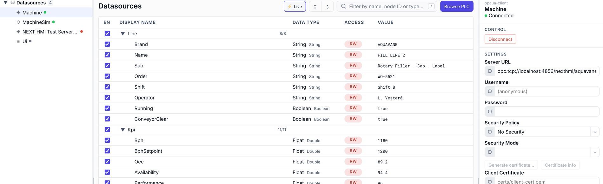
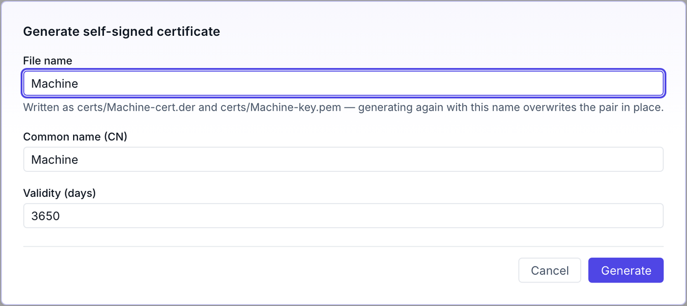
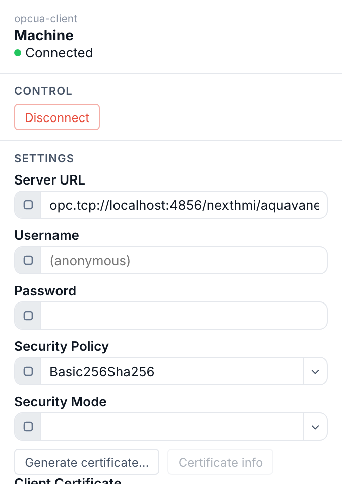

# Connecting to data

A **datasource** is a named connection with a tree of variables under it. Connect to a PLC over OPC-UA with the guided wizard, or use a static datasource to mock values while you design. Then browse the address space into a tree your pages can bind to.

## Connect to a PLC with the OPC-UA wizard

The connection wizard walks three steps — **Connection**, **Sign-in**, **Sync** — and can discover a server's endpoints for you.

1. **Enter the server address** — On the **Connection** step, type the endpoint — `opc.tcp://192.168.1.10:4840` (or just `host:port`). Give the datasource a **name** like `LinePLC`; that name becomes the prefix in every binding (`LinePLC:…`).
2. **Discover endpoints (optional)** — Click **Discover endpoints instead** and then **Discover**. NEXT HMI queries the server and lists each endpoint with its **security policy**, **mode**, and accepted **user tokens**. Pick one — the most secure is preselected — and its security settings fill in for you.
3. **Choose how to sign in** — On **Sign-in**, pick **Anonymous** or **Username & password**. The wizard offers only what the chosen endpoint actually accepts.
4. **Test, then create** — On **Sync**, hit **Test connection** — a green *Connected — <server name>* confirms it. Create the datasource; it starts connecting immediately, and you can jump straight to **Browse variables**. On a secured endpoint with a username, the test stops at *The server certificate is not trusted yet* unless you uploaded the server certificate: create the datasource, then [trust the certificate](#trust-the-server-certificate) in its properties.

> [!NOTE]
> Under the hood an `asyncua` client pool handles the session.

## Secure the connection with certificates

Pick anything other than **No Security** as the **Security Policy** and the
connection needs a client certificate — the identity your HMI presents to the
server. The certificate fields appear on the wizard's **Sign-in** step as soon
as a secured policy is chosen, and on the datasource's properties panel under
**Settings**, so an existing connection can be secured later without rebuilding
it.

You have two ways to get that certificate in place.

1. **Generate one here** — Click **Generate certificate…**. Give it a **File
   name**, a **Common name (CN)** and a **Validity** in days (ten years by
   default). NEXT HMI writes a self-signed RSA-2048 pair into the project's
   `certs/` folder — `certs/<name>-cert.der` and `certs/<name>-key.pem` — and
   fills the **Client Certificate** and **Client Private Key** fields in for
   you. DER is the encoding an OPC-UA PKI store (UaExpert, Optix, …) imports.

   

2. **Upload one you already have** — Use the file pickers on **Client
   Certificate**, **Client Private Key** and **Server Certificate**. Each
   upload is stored in `certs/` under a sanitised filename. A **Private Key
   Password** field sits beside them for an encrypted key; it stays a plain
   setting and is never uploaded as a file.

Whichever route you take, the server has to **trust** the certificate before it
will accept the session. Most servers park a first, rejected connection
attempt in a *rejected certificates* folder — move it to the trusted list
there, then connect again.

**Check what you have.** **Certificate info** reads the certificate back and
shows its subject, its fingerprint, when it was issued and when it expires, its
subject alt names, and whether it is self-signed. The status line is the part
to watch: *Valid*, *Expires in N days* inside the 90-day warning window, or
*Expired N days ago*. The button stays disabled until a certificate path is
set, and a path holding no readable certificate says so plainly rather than
failing.

> [!TIP]
> **Renewing is re-generating.** Generating again with the same **File name**
> overwrites the pair in place rather than accumulating files — so an expiring
> certificate is one click, followed by re-trusting it on the server.

## Trust the server certificate

Trust runs both ways: the PLC checks your certificate, and NEXT HMI checks the
PLC's. When a secured datasource connects and no server certificate is trusted
yet, the properties panel shows a **Server certificate** card with what the
server presented — its **Subject**, **Issuer**, **Valid until** date and
**SHA-256** fingerprint — and the datasource carries a **Not trusted** chip in
the tree.

1. **Compare the fingerprint** with the server certificate in the PLC's own
   OPC UA settings. Every character has to match.
2. **Click Trust certificate.** NEXT HMI stores exactly that certificate as
   `certs/<datasource>-server.der`, sets it as the **Server Certificate**, and
   reconnects. **Not now** folds the card to one line with a **Review
   certificate** button, and changes nothing.

**The username and password are sent only after you trust the certificate.**
Until then a datasource that signs in with a username does not connect, and
the card says the connection waits for you. A machine on the network posing as
the PLC never gets the password. An anonymous secured connection has no
password to protect, so it connects while untrusted — but until you trust the
certificate it cannot tell the PLC from an impostor.

**When the certificate changes, the connection stops**, anonymous or not, and
the card turns red: *The server certificate changed since you trusted it*. A
PLC that was reset, re-commissioned or given a renewed certificate does this,
and so does someone intercepting the connection. Check the new fingerprint
against the PLC before you trust it.

Uploading the server's certificate as the **Server Certificate** does the same
as trusting it here.

> [!NOTE]
> **After an update from an earlier version**, a secured datasource that signs
> in with a username and has no **Server Certificate** set stops at *not
> trusted yet* until you trust its certificate — one click per datasource. An
> imported project arrives without its `certs/` folder, so its secured
> datasources ask once too.

## Connect, disconnect, and see why it failed

An OPC-UA datasource's properties panel opens with a **Control** section
holding **Connect** and **Disconnect**. They do what they say: the connection
stays down until you ask for it, and stays down after you disconnect rather
than quietly retrying. The button reads *Connecting…* / *Disconnecting…* while
the change is in flight.

The panel header carries the state beside the datasource name — a green dot and
**Connected**, or **Disconnected**. When a connect attempt fails, the reason
from the server is printed underneath it: a refused client certificate, a bad
username, an unreachable host. A server certificate still to be trusted is the
exception: the **Server certificate** card says so instead (see
[above](#trust-the-server-certificate)). That message is the first place to
look when a screen shows no data; [Diagnostics](diagnostics.md) covers the
rest.

> [!NOTE]
> **The local test server is started the same way.** A test-server datasource
> shows **Running** / **Stopped** instead, with its own start and stop buttons,
> and **Listening on** with the address a client connects to while it runs.
> Its **Security Endpoints** checkboxes decide which secured policies it
> advertises — NoSecurity is always available — which is how you exercise the
> discovery and certificate flow above without a real PLC on the bench.
>
> It listens on this computer only (`127.0.0.1`). Turn **Reachable from the
> network** on to reach it from another machine — a PLC tool, a second panel —
> and every device on the network can connect and change its writable values,
> so use that only on an isolated network. **Listening on** then names the
> address you opened the editor at, or `<this device's address>` when that
> was `localhost`. Sign-in is anonymous only, and a client writes exactly what
> each variable's access level allows.

## Design offline with a static datasource

No PLC handy? A **static** datasource is a variable tree you define by hand, with no connection behind it. Bindings, writes and actions behave exactly as they will against a live server, so you can build and demo a whole screen set before the panel is wired.

1. **Add it** — Click the `+` on the **Datasources** row and choose **Static Variables**. Name it (`Demo`, `Line1Mock`) — the name is the binding prefix, same as for a real connection.
2. **Add variables** — Right-click in the variable table and pick **Variable**, **Folder**, **Array** or **Array Struct**. A folder groups variables; an array asks for its length.
3. **Fill the row in** — **Display Name**, a **Data Type** from the simple list (`Boolean`, `Integer`, `Float`, `String`, `DateTime`, …), and **Access** — mark it writable if a control should push values to it. NEXT HMI records a representative OPC-UA type behind your choice, so nothing changes in your pages when you swap in a real server later.
4. **Watch the values** — Toggle **⚡ Live** in the toolbar for a **Value** column showing what each variable holds right now.

> [!NOTE]
> **Static values live in memory only.** Every variable starts at its type's zero value (`0`, `false`, `""`, and `1970-01-01T00:00:00.000Z` for a DateTime) and holds whatever the HMI writes to it while the project runs. Nothing is written to disk, so a restart puts the whole tree back to zero — the definitions persist, the values don't.

## Browse the address space into a tree

Open the datasource and browse. Each variable is recorded with its real OPC-UA **data type**, whether it's **writable**, and (for arrays) its **length**. Variables live in a tree of four bindable shapes plus organising folders:

| Node | What it is | Binds as |
|---|---|---|
| **Scalar** | A single value. | one number / string / bool… |
| **Array** | A scalar repeated N times. | the whole array, or one element by `index` |
| **Struct** | A folder that holds variables — a named group. | the whole object, or a member by path |
| **Struct array** | A struct repeated N times. | the array of objects, or one struct |
| **Folder** | Pure organisation (only folders inside). | not bindable |

OPC-UA's many data types collapse to eight simple ones at the HMI boundary — `Boolean`, `Integer`, `Float`, `String`, `DateTime`, `Date`, `Time` and `Duration`: every `Int16/UInt32/…` becomes `Integer`, every `Float/Double` becomes `Float` — so a widget field never sees a wire type. A tag binds only to a field of its own simple type, except that an `Integer` tag also fills a `Float` field that only reads; see [Coercion, in short](properties.md#coercion-in-short).

A browsed tag arrives disabled. Tick its enable checkbox before binding it: the variable picker lists only enabled tags, and refuses a disabled one even under **Show all**. Disable a tag that is already bound and the warnings pill reports it as *disabled in its datasource* until you enable it again or rebind the widget. The HMI never reads or writes a disabled tag: it gets no value on a screen or in the **⚡ Live** column, and a write to it fails with `disabled`. Enable only what the screens need.

**Browse PLC** starts at the server's *Objects* folder, or at the **Browse Root Node** set in the datasource's properties. From *Objects* it skips the server's own `Server` object — its diagnostics, capabilities and namespace table: hundreds of nodes and no PLC tags. To bind one of those, such as `ServerStatus/CurrentTime`, set **Browse Root Node** to `i=2253` (or to the node inside it you want) and browse again.

A re-browse compares the server with your tree and lists what was added, modified and *removed from server* for you to accept. A variable the browse did not reach is not counted as removed while the server still has it — so tags imported earlier from under `Server`, or from outside the current browse root, stay as they are, enabled and bound.

Two kinds of value read differently from how a PLC tool shows them:

- **A `DateTime` reads as UTC.** A Text widget bound to one shows `2026-01-02T03:04:05.678Z` — date, `T`, time to the millisecond, `Z` for UTC — whatever the panel's time zone.
- **A very large `Int64`/`UInt64`** — beyond 9,007,199,254,740,991, a long-running counter for instance — arrives as text holding every digit. A Text widget shows it exactly; a number field still reads it, rounded to the nearest number a browser holds. To write one back, send it as text too.

Next: [bind and subscribe →](subscribing.md)
