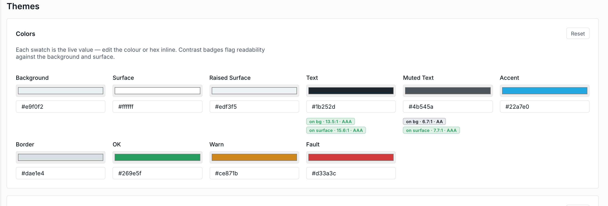

# Theming

Colour, type, spacing and radii are defined once as **tokens** and every widget reads them. Restyle the whole project — or match a customer's brand — without touching a single page.

## How theming works

Widgets never hardcode a colour or a font size; they reference theme tokens (the `--hmi-*` custom properties). Change a token in the **Themes** area and every widget that uses it updates at once. A widget property only *overrides* the theme when you deliberately set it — leave it unset and it tracks the token.

## Set up a theme

1. **Open the Themes area** — Pick **Themes** in the editor's left rail. Tokens are grouped — colours, typography, containers, and more.
2. **Set the core colours** — Define **bg**, **surface** and **text**, plus your **accent**. The editor shows live **contrast checks** (text on bg, text on surface) so you keep it legible.
3. **Choose typefaces** — Pick a UI font and a mono font. Several are bundled ready to use — **Inter**, **Manrope**, **Lexend**, **Exo 2**, and **Roboto Mono** / **JetBrains Mono**.
4. **Dial in shape & spacing** — Set the base **radius** and spacing tokens so cards, buttons and inputs share one consistent feel.
5. **Tune the numpad and keyboard** — The **Numpad & keyboard** section styles the on-screen numpad and keyboard that inputs open: **Numpad columns** (3 puts Back, Clear and Enter under the digits; 4 puts them in a column on the right), **Key size** (on the keyboard only the height), **Key gap**, the key font, and the **Enter key colour**. Leave a field empty and it follows the rest of the theme.
6. **Place and colour the toasts** — The **Toasts** section sets where Show Toast notifications appear (**Position**: top or bottom, left, center or right; top center by default), their **Shape** (**Rounded**, with the theme radius, or **Pill**), and a background and text colour for each severity: info, success, warning and error. Leave a colour empty and the toast keeps its tint of the severity colour. Alarm toasts are not affected.

> [!TIP]
> Because the theme is just tokens on disk, you can keep per-customer themes in version control and swap them per deployment — same pages, different brand.
