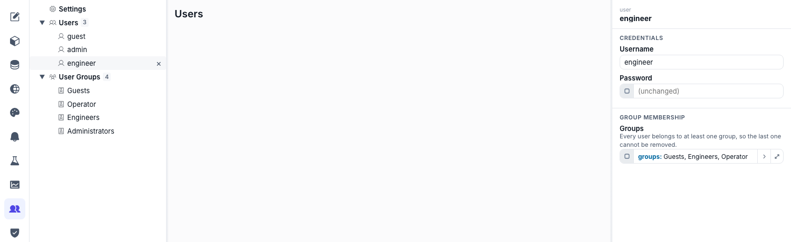

# Users, groups & permissions

Who is at the panel decides what they see and what they may change. NEXT HMI answers that with **groups** — a user belongs to one or more, and everything else (a hidden button, a read-only setpoint) is a group test. There is no scripting anywhere in this.

## The model in four sentences

- A **group** is a label with an id — `guest`, `operator`, `engineer`, `admin` ship by default. Add your own freely.
- A **user** is a username, a password, and at least one group.
- **`guest`** is the built-in anonymous identity: it always exists, always belongs only to the `guest` group, and can never be given a password. It is who you are before signing in.
- **Every screen decides for itself** what a given group may see or touch, using the `$userGroups` source on the widget's **Visible** and **Interactable** fields.

All of it lives in `users.json` inside the project folder, with passwords stored hashed — never in plain text, and never sent back to the browser.

## Add users and groups

1. **Open the Users area** — Pick **Users** in the editor's left rail. The tree lists **Settings**, then your groups, then your users.
2. **Add a group** — Give it a **Label**; the **id** is fixed at creation and is what bindings refer to. Keep ids short and stable (`maintenance`, `shift-lead`) — renaming the label is free, the id is not.
3. **Add a user** — Set the **Username**, a **Password**, and tick the **Groups** they belong to. A user must keep at least one group, so the last one cannot be removed.
4. **Save users** — Accounts save on their own **Save users** button in the header, separate from the normal Save, so a security change is never carried along by an unrelated page edit. **Discard users** throws the draft away.

A saved change reaches a running project's panels at once: a removed user, or one whose password changed, is signed out (the panel falls back to the auto-login user), and a user whose groups changed gets the new groups on the panel they are signed in on.

> [!NOTE]
> **The password field never shows you the current password.** It reads *(unchanged)* once one is set — the server only stores a hash. Type a new one to replace it; leave it alone and the existing one is kept.

> [!IMPORTANT]
> **A user with no password set cannot sign in at all.** Nobody can log in as that account — not with a blank password, not with any password — until you give it one. It still works as the **auto-login user**, which is how `guest` (an account that can never have a password) is the identity a panel starts out as. So a half-finished account is never a way in.
>
> **Repeated wrong passwords lock that username out for a minute.** Five in a row and even the right password is refused until the minute is up; the operator sees the login action fail with `rate_limited` rather than `invalid_credentials`. Other users are unaffected. A live view is reachable by anyone who can reach the panel, so this is what stands between it and someone guessing at an account all afternoon.

## Settings: auto-login and user admins

Select **Settings** in the tree for the project-wide choices:

| Setting | Means |
|---|---|
| **Auto-login user** | Who a freshly opened runtime is signed in as before anyone touches it, and who it goes back to when someone signs out. `guest` is the normal answer; picking a real user makes an unattended panel start out with that user's rights. |
| **User admins** | The groups whose members may add, change and delete users from the runtime — see [Manage users from the runtime](#manage-users-from-the-runtime). `Admin` by default; empty means nobody. |

Each user also has a **Runtime** section:

| Setting | Means |
|---|---|
| **Language** | The language the screens switch to when this user signs in. *(none)* leaves the language as it is. |
| **Prevent delete** | The runtime cannot delete this account. |
| **Lock password** | The runtime cannot change this password — not a user admin, and not the user themselves. Right for a shared account. |
| **Lock groups** | The runtime cannot change this account's groups. |

The locks apply to the runtime only. Here in the editor, and over the API, you can still change everything.

> [!IMPORTANT]
> **No group opens the editor.** The fence around the project itself is the installation's **device-admin password** — the one that unlocks the Manager dashboard — and nothing in `users.json` widens or narrows it. Whoever has that password can rewrite pages, alarms and users, whichever project user the runtime happens to be signed in as, so keep it to the people who genuinely engineer the system. See [How this relates to the device-admin password](#how-this-relates-to-the-device-admin-password).

## Sign in and out on a screen

Who is signed in, and the way in and out, are ordinary widgets in the header:

| Widget | Shows | Bound to |
|---|---|---|
| **Label** | The username, or their groups | **Text** → `$user` → **Username** or **Groups** |
| **Button** *Sign in* | Only to the guest | **Visible** → **Compare** `$user` → **Username** `===` `guest`; **On Pressed** → **Open Dialog** on your sign-in dialog |
| **Button** *Sign out* | To everyone else | **Visible** → **Not** of that same comparison; **On Pressed** → **Logout User** |

Leave the buttons out on a panel that never signs anyone out. The NEXT BREW
example template wires exactly this in its header, around a user **Icon**.

**Building the dialog itself.** The sign-in dialog behind that button is layout
like any other screen, wired with actions ([Actions](actions.md)):

- **Log in** — a **Login User** action whose **Username** and **Password** are bound to wherever the operator typed them (a Dropdown's or String Input's `$widgetProp`, a component input, a `$static` for a fixed kiosk account). A Dropdown whose **Options** come from `$user` → **All users** offers every account by name and hands over the username, which is what Login User takes — the NEXT BREW sign-in dialog does exactly this. It runs asynchronously: use `onFailed` to show a toast on a wrong password, `onSuccess` to close the dialog.
- **Log out** — a **Logout User** action drops the session back to the auto-login user.

> [!TIP]
> Tick **Password field** on the String Input holding the password so the entry
> is masked. It deliberately keeps browser keychains out, so a panel PC never
> offers to save — or auto-fill — an operator's credentials.
>
> For a PIN, set its **Keyboard** to **Keypad** as well: the field becomes the
> numpad itself, digits only and masked, so the dialog is one panel. Put the
> Login User action in the field's **On Submit** and it signs in on **Enter**,
> then clears the entry for the next try. **Numeric** instead keeps a plain
> field that opens the numpad over the dialog when tapped; **Focus when shown**
> opens it straight away.

Sign-in is **per open runtime**, not per browser and not per installation: two tabs on the same panel PC can be two different operators, and each keeps its own identity until it is closed or logged out.

**Signing in from another system.** A badge reader or a MES can sign an operator in or out on a panel over the API, with that operator's own password. The panel needs a name for that: open its runtime with `?panel=<name>` at the end of the address, for example `/runtime/line-a/?panel=line-a-1` (letters, digits, `-` and `_`). Screens opened with the same name are signed in and out together; a screen without the parameter cannot be reached this way. The name proves nothing: anyone who can reach the runtime can open it with the same `?panel=` and receives the same sign-ins, so use this only on panels on a trusted network, in a kiosk browser nobody else controls. See [Panels: sign users in and out](api.md#panels-sign-users-in-and-out).

Global events give the rest of the plumbing — `onUserLoggedIn` and `onUserLoggedOut` fire project-wide, which is where "go to the home page on login, back to the lock screen on logout" belongs. See [Global events](actions.md#global-events).

## Gate what a group can see and do

Every widget carries **Visible** and **Interactable** in its **Visibility** group. Both are plain booleans, so any source can drive them — but the one you want here is **`$userGroups`**, which is true when the signed-in user is in one of the groups you tick (an empty list means *everyone*).

Both already arrive on that source. A newly placed widget has **Visible** and **Interactable** wired to `$userGroups` with an empty group list, so gating one is ticking the groups — there is no source to switch first, and a widget you never touch stays visible and operable for everyone.

| Goal | Set |
|---|---|
| Hide a maintenance panel from operators | **Visible** → `$userGroups` → `engineer`, `admin` |
| Show a Start button to everyone but let only operators press it | **Interactable** → `$userGroups` → `operator` |
| Show different text per role | any `String` field → `$if` with a `$userGroups` condition |

### What a locked widget does

A widget that is not **Interactable** renders read-only rather than disappearing — the operator can see the setpoint and see that it is not theirs to change. It is dimmed, and pressing it does nothing. The keyboard cannot reach it either: **Tab** skips it, so **Enter** or **Space** cannot fire it, and a screen reader announces it as unavailable.

Whether the press *says* anything is a project-wide choice: the editor's **Settings** panel (see [Layout & the shell](layout.md)) carries **Locked feedback** with three modes.

| Mode | On press |
|---|---|
| **Marker at pointer** (default) | A ⊘ marker flashes where the finger or cursor landed. |
| **Notification** | A warning toast reads *Interaction not permitted*, dismissible and self-clearing. Hammering the same widget re-uses the toast already on screen. |
| **None** | Nothing — the press is swallowed silently, and the widget carries no tooltip either. |

Pick **Notification** for a panel where a small flash is easy to miss, **None** where a locked control should read as plain decoration.

To offer a sign-in instead, attach an **Open Dialog** pointing at your sign-in dialog to the **onInteractionDenied** global event (see [Global events](actions.md#global-events)). It fires on every locked press, whatever the mode, so pair it with **None** if the dialog should be the only answer. It fires for any locked widget, including one locked by a variable rather than by a group.

Two more sources read the identity directly, for labels and lists rather than gates: **`$user`** gives the signed-in **username** or their **groups** as text. On a list field — a Dropdown's **Options**, a Repeater's **Items** — it lists **All users** (each valued by username), **All user groups**, or **Accounts (user admins)** instead, the raw material for a user-picker or user-management screen.

## Manage users from the runtime

The people at the machine can look after their own accounts: a shift lead adds a new operator, resets a forgotten password, sets someone's language. You build that screen yourself from ordinary widgets and three actions:

| Piece | How |
|---|---|
| **The list** | A **Repeater** whose **Items** come from `$user` → **Accounts (user admins)**. Each copy reads the account with **Repeat Item**: `value` (the username), `groups` (the group labels), `groupIds`, `language`, and `lockedDelete`, `lockedPassword`, `lockedGroups` to disable a button the server would refuse anyway. |
| **Add or change** | An **Update User** action, its fields bound to a String Input (tick **Password field** for the password), a Dropdown on `$user` → **All user groups** for one group, a Dropdown with your languages. A new username creates the account, which then needs a group and a password; for an existing one an empty field leaves that part unchanged. |
| **Delete** | A **Delete User** action with **Username** from the row's **Repeat Item** `value`. |
| **Own password** | A **Change Own Password** action with the current and the new password, for anyone signed in. |

Put a Show Toast with `$result` → `reason` in each action's **onFailed** so a refusal reads as one.

**Who may do it.** Only members of a **User admins** group may add, change or delete users, and only they get the Accounts list — for everyone else it is empty. The server checks this against who is signed in on that screen, so a hidden button is a convenience, not the protection. On top of that, nobody can delete their own account or take away their own user-admin group, so a user admin always remains; and the locks you set per account in the editor hold whatever the screen asks.

Every change reaches the other panels at once: a deleted user is signed out, a changed password ends that user's other sign-ins, and an open editor shows the new accounts.

**Accounts survive a new version of the project.** When you replace the project on a machine with a transfer, the accounts there stay: groups and settings come from your project, accounts, passwords and languages from the machine. Untick **Keep the users on the destination** in the transfer window to overwrite them with the accounts from the editor instead. A group a kept account still uses but your new version no longer has is put back, so nobody loses access without anyone deciding so. See [Push & pull between devices](projects.md#push--pull-between-devices).

## What the server enforces

The server does not restrict who may write a writable variable. Groups decide what the panel shows and lets an operator press; once a write reaches the server, the only check is whether the variable is marked **writable** in its datasource — a read-only variable is refused with `read_only` for everyone.

So hiding or blocking the button — **Visible** / **Interactable** on the widget — is how a project stops operators changing a value. A setpoint no button writes cannot be changed from the panel.

That holds for anyone who reaches the panel, signed in or not ([What is reachable without a password](network-access.md)), so leave a variable read-only in its datasource when nothing on the screens needs to change it.

Signing in does change the record. A write, a recipe load and an alarm acknowledgement from a button are attributed to the user signed in on that screen, or to `guest` when nobody is. A recipe load from a custom widget's `recipeDownload` carries no sign-in and is always recorded as `guest`. The same actions from the editor's Test mode are recorded as `engineer`, whoever the preview is signed in as: the editor sits behind the device-admin password, not a project user.

## How this relates to the device-admin password

Two separate credentials exist, and mixing them up is the usual confusion:

| Credential | Gates | Lives in |
|---|---|---|
| **Device-admin password** | The **Manager** dashboard — starting, stopping, importing, transferring projects — and the **editor** behind it. | The installation, not any project. |
| **A project user's password** | Signing in on *this project's* screens, and whatever that user's groups allow. | `users.json` in the project. |

Groups decide what a signed-in operator sees and may touch on the screens. They never decide who may edit the project — that is the device-admin password, full stop.

> [!IMPORTANT]
> **A running project's screens are open — no password at all.** `/runtime/<slug>/` is reachable by anyone who can reach the panel, which is what an HMI is for: an operator walks up and works. The device-admin password guards the editor and the dashboard, not the live view.
>
> The live view can also list every username and group name — that is what fills a sign-in dropdown — but not who belongs to which group, or which accounts have a password. Group membership reaches only a user admin signed in on that screen (for the [Accounts list](#manage-users-from-the-runtime)); the rest stays behind the device-admin password.
>
> That means operating is open too — pressing a button, changing a setpoint, writing a tag. The server does not restrict who may write a writable variable; blocking the button is how a project stops it (see [What the server enforces](#what-the-server-enforces)). [What is reachable without a password](network-access.md) lists everything the live view leaves open.

A project copied from the seed ships **no accounts at all** beyond the anonymous `guest`, so there is no reusable credential to leak between installs and nothing to type before the project opens. Every real account is one you add here. See [Managing projects](projects.md#the-manager-dashboard).

## If `users.json` goes bad

On startup an unreadable or structurally invalid `users.json` is backed up next to itself as `users.json.bak.invalid.<timestamp>` and replaced with the defaults — the anonymous `guest` and the four stock groups, no other account. You lose the accounts, not the project, and the original file is still there to read.
