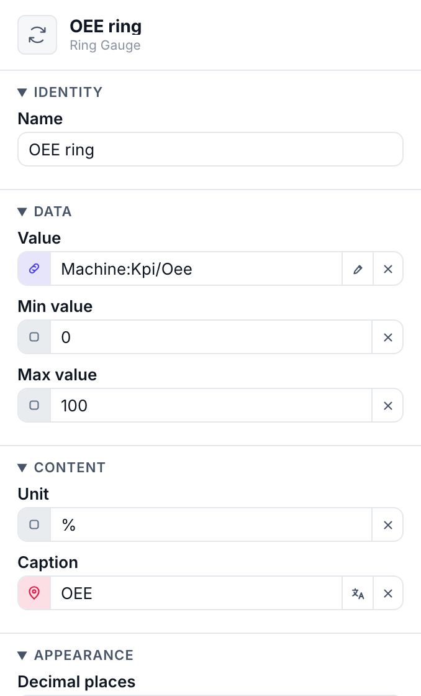

# Adding & arranging widgets

Widgets are the pieces you drop on a page. This chapter covers placing them, moving and nesting them in the tree, and configuring them through the schema-driven properties panel.

## Place a widget

1. **Open the picker** — Right-click a page or a container in the widget tree (or click the `+` on the row) and choose **Add Widget/Component…**. A searchable drawer opens with one card per type — icon, name and description — grouped by category, each badged **Built-in**, **Custom** or **Component**.
2. **Pick a type** — Search by name or scan the categories, then click the card — say **Button** or **Icon**. It's inserted into the tree at the point you clicked and selected for you.
3. **Position it in the tree** — Use **Move up** / **Move down** or drag the row to set stacking order, and drop it inside a **Container** to nest it. A placed **Component** that declares slots hosts widgets the same way — one group per slot in the tree ([slots →](properties.md#passing-widgets-into-a-component-slots)).
4. **Configure it on the right** — The properties panel lists exactly the fields this widget declares. Fill them in — many can be bound to live data instead of typed literally. The panel header says what you selected — *Widget · Button*, or *Component · Motor* for a placed component, which links straight to that component in the **Components** area, where its own design is edited.

> [!TIP]
> **Don't know the name?** The picker searches names, types and descriptions, so typing part of what you're after is enough — the drawer is the only way to pick a type, so there are no sub-menus to scan.

> [!TIP]
> **Containers are added their own way.** A `Container` has its own **Add Container** menu item rather than living in the widget list, because it's the thing that *hosts* other widgets. Drop widgets into it to build layout — see [Layout](layout.md).

## Schema-driven properties

Every widget declares a **schema** — the list of fields it exposes and the type of each. The panel renders the correct editor per field, so you never type a color into a text box:

- a `color` field opens a color picker (with theme-token support),
- an `icon` field opens the icon picker, an `image` field the asset picker,
- a `select` shows a dropdown of allowed values,
- a `struct` field (custom widgets can declare one) binds a struct variable that carries every member the field asks for.

Most fields also carry a small **source pill** — that's where a static value becomes a live binding. Full detail in [Dynamic properties](properties.md).

## Make controls do something: actions

Interactive widgets (**Button**, **Menu Toggle**, and a **Button Container** — a Container you press as a whole) have an **Actions** field holding a list that runs, top to bottom, when the control is pressed; others, such as a Dropdown's **On Change**, run one on their own event. The fourteen action types cover five jobs:

- **Screens** — open or close a **dialog**, or open an ordinary page as a **page overlay**.
- **Machine** — **write a variable** (set a coil, a mode, a setpoint), **toggle a Boolean**, or **load / save a recipe**.
- **Session** — **log a user in or out**.
- **Interface** — switch **language** or **theme**, raise a **toast**, or put a confirm **alert** in front of a dangerous write.
- **Logic** — run one list or another on a condition with **If / Else**.

The six that cross the wire carry `onSuccess` / `onFailed` / `onSettled` handler lists, whose actions can read the outcome with `$result`. Full catalog, fields and worked examples: [Actions & events](actions.md).

> [!NOTE]
> **Moving between pages is not an action.** Navigation widgets read the page tree instead — see [Pages & navigation](pages.md#give-operators-a-way-around).

> [!NOTE]
> **Visibility & permissions.** Every widget exposes **Visible** and **Interactable** booleans, and both arrive already wired to the `$userGroups` source with no groups ticked. Tick the groups and it becomes a group test — a Start button restricted to *operator* renders read-only for everyone else, with no scripting and no source to switch first. See [Users, groups & permissions](users.md#gate-what-a-group-can-see-and-do).

> [!TIP]
> **Showing who is signed in.** A Label bound to `$user` names the current user, and two Buttons gated on the guest sign in and out — see [Sign in and out on a screen](users.md#sign-in-and-out-on-a-screen).

## Show another site: the Web Frame

A **Web Frame** shows a web page inside the panel — a supplier portal, a camera's own page, a device's diagnostics. Its **sandbox** is on unless you turn it off; allow only what the page needs.

The frame and the page it shows can exchange messages:

- **Outbound variable** — each new value is posted to the page, and only to the **Outbound target origin**. Left empty (**Same as the URL**, the default) that is the origin of the URL: `https://portal.example.com` for `https://portal.example.com/orders`. The panel shows it under the field. A URL with no origin of its own — empty, a relative path, `about:blank`, a `data:` URL — gets nothing.
- **Allowed inbound origins** — the sites whose messages the frame accepts, comma-separated. Each accepted message runs **On Message** and is written to the **Inbound variable**, so list only sites you trust to write that variable. `*` is not allowed: the frame ignores it, so with no site listed it ignores every message. Neither is `null`, the origin a sandboxed page sends from unless **Allow same-origin** is on, since every site the frame could show shares it. To take messages from a page in the sandbox, turn on **Allow scripts** and **Allow same-origin** and list its site.

When the URL comes from a variable, a URL parameter or any other source and the sandbox is off, the properties panel warns: whoever can change that source decides which site the panel shows, with full access to its messages. **Turn on sandbox** in the warning switches it back on.

> [!IMPORTANT]
> **What changed for existing Web Frames.** A fixed URL with its site listed keeps working as before. The rest now behaves like this, and the [warnings pill](diagnostics.md#the-warnings-pill) reports each case:
>
> | Setting | Before | Now |
> |---|---|---|
> | Outbound target origin, empty | `*` | The origin of the URL |
> | Outbound target origin, `*` | Sent to any site | Treated as the origin of the URL; a warning |
> | Allowed inbound origins, `*` or `null` | Every message accepted | Every message ignored until sites are listed; an error |
> | URL from a variable, sandbox off | No notice | A warning in the panel |
